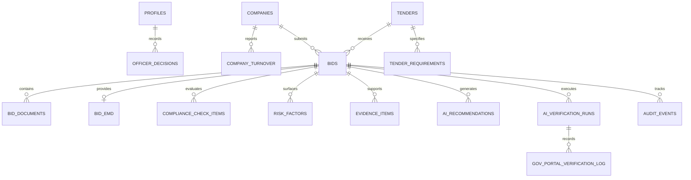

# CSAP Database Schema & Data Architecture

The Central Statutory Authentication Platform (CSAP) utilizes a PostgreSQL schema managed through Supabase migrations.

## Entity Relationship Overview



## Primary Tables

| Table | Description |
|---|---|
| `profiles` | User profiles linked to `auth.users` with designation, organization, badge ID, and role. |
| `companies` | Vendor master records: legal name, GSTIN, PAN, Udyam registration number, incorporate date. |
| `company_turnover` | Annual turnover records per financial year for turnover eligibility validation. |
| `tenders` | Tender opportunities, values, EMD amounts, technical opening deadlines, status. |
| `tender_requirements` | Individual requirements across Statutory, Financial, Technical, EMD, and Policy categories. |
| `bids` | Submissions by vendors against tenders with quoted amount, completion timeline, and evaluation status. |
| `bid_documents` | Uploaded statutory documents, OCR status, checksums, and extraction metadata. |
| `bid_emd` | EMD bank guarantee, payment receipt, SFMS transaction reference, and verification status. |
| `compliance_check_items` | Requirement-by-requirement verification status (Verified, Manual Review, Mismatch, Exempted). |
| `risk_factors` | Surfaced risk indicators across statutory, financial, document, and policy vectors. |
| `evidence_items` | Line-item evidence citations cross-referencing bidder documents and government registries. |
| `ai_recommendations` | AI advisory recommendations with confidence score and pro/con points. |
| `officer_decisions` | Official human officer recorded decision (Approve, Reject, Clarification, Committee). |
| `ai_verification_runs` | Run lifecycle records for the 6-step automated verification process. |
| `gov_portal_verification_log` | Detailed request/response telemetry with GSTN, MCA21, EPFO, ESIC, and Income Tax portals. |
| `audit_events` | Immutable timeline of all system and officer actions for statutory accountability. |

## Migration Files

1. `20260907140000_csap_schema.sql` — Base extensions, enums, tables, indexes, views, and RLS policies.
2. `20260907141000_csap_schema_fixes.sql` — Schema adjustments and integrity refinements.

## Running Migrations & Seeding

```bash
# Apply migrations using Supabase CLI
supabase db push

# Or run seed script using TSX
npm run seed
```

## Storage conventions used by the BidSure backend (2026-09)

The application's domain model (`shared/domain/types.ts`) is stored in the existing schema
without migrations. Where no dedicated column exists, these natural-key conventions apply.
They are implemented once in `backend/src/db/conventions.ts` and used by both the backend and
`seeds/seed.ts`.

| Domain field | Stored as |
| --- | --- |
| Compliance check ↔ tender requirement | `compliance_check_items.display_code` = requirement `display_code` (e.g. `REQ-06`), one row per requirement per bid |
| Check status (`MET`/`EXEMPTED`/`REVIEW`/`NOT_MET`/`MISSING`) | `VERIFIED`/`EXEMPTED`/`MANUAL_REVIEW`/`MISMATCH`/`PENDING` |
| Check "submitted" + note | `compliance_check_items.notes` = `"<submitted>\n<note>"` |
| Document ↔ requirement, requirement clause | `bid_documents.tender_clause_reference` = `"REQ-05 · Clause 5.1(b)"` |
| Finding ↔ requirement | `evidence_items.requirement_title` = `"REQ-06 · Earnest Money Deposit (EMD)"` |
| Finding severity | `finding_type`: HIGH=`NON_COMPLIANCE`, MEDIUM=`MANUAL_REVIEW`, LOW=`AMBIGUITY` |
| Finding detail (submitted, comparison, impact, action) | latest completed `ai_verification_runs.steps` with `kind = "bidsure.verification.v1"` (`checks[].finding`) |
| Bid status, finding status | Derived from the latest `officer_decisions` row (never stored) |
| MSE category | Parsed from the bidder's Udyam certificate text |

Recommended next migration: add explicit columns/FKs for the above (e.g.
`compliance_check_items.requirement_id`, `evidence_items.severity/expected/submitted/comparison/impact`)
and drop the conventions.

## Document verification pipeline (migration 20260926120000)

| Table / object | Purpose |
| --- | --- |
| `document_verification_runs` | One row per PAN pipeline run: `document`, `ocr_result` (NVIDIA OCR), `extraction_result` (NVIDIA extraction), `api_request`, `api_response`, `comparison`, `verdict`, `status`. Updated after each stage; published to Realtime. `REPLICA IDENTITY FULL` (migration 20260926130000) so Realtime receives complete rows. |
| `external_api_calls` | Log of every call CSAP makes to an external verification API (request, status, response, latency). |
| `bid_documents.storage_path`, `mime_type` | Location of the stored file in bucket `bid-documents`. |
| Storage bucket `bid-documents` | Private; PNG/JPEG; 5 MB limit. Paths: `BID-xxx/…` (bid package), `samples/…`, `uploads/BID-xxx/…`. |
| Publication `supabase_realtime` | `ai_verification_runs`, `document_verification_runs`, `officer_decisions`, `audit_events`. |

Migrations are applied with `npm run migrate` (records applied files in `public._bidsure_migrations`).
