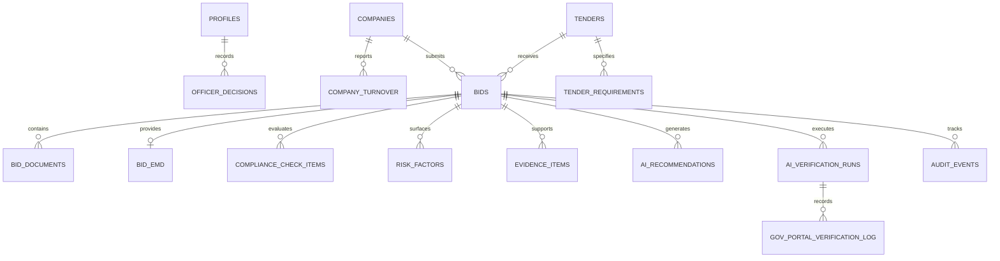

# CSAP Database Schema & Data Architecture

The Central Statutory Authentication Platform (CSAP) utilizes a PostgreSQL schema managed through Supabase migrations.

## Entity Relationship Overview



## Primary Tables

| Table | Description |
|---|---|
| `profiles` | User profiles linked to `auth.users` with designation, organization, badge ID, and role. |
| `companies` | Vendor master records: legal name, GSTIN, PAN, Udyam registration number, incorporate date. |
| `company_turnover` | Annual turnover records per financial year for turnover eligibility validation. |
| `tenders` | Tender opportunities, values, EMD amounts, technical opening deadlines, status. |
| `tender_requirements` | Individual requirements across Statutory, Financial, Technical, EMD, and Policy categories. |
| `bids` | Submissions by vendors against tenders with quoted amount, completion timeline, and evaluation status. |
| `bid_documents` | Uploaded statutory documents, OCR status, checksums, and extraction metadata. |
| `bid_emd` | EMD bank guarantee, payment receipt, SFMS transaction reference, and verification status. |
| `compliance_check_items` | Requirement-by-requirement verification status (Verified, Manual Review, Mismatch, Exempted). |
| `risk_factors` | Surfaced risk indicators across statutory, financial, document, and policy vectors. |
| `evidence_items` | Line-item evidence citations cross-referencing bidder documents and government registries. |
| `ai_recommendations` | AI advisory recommendations with confidence score and pro/con points. |
| `officer_decisions` | Official human officer recorded decision (Approve, Reject, Clarification, Committee). |
| `ai_verification_runs` | Run lifecycle records for the 6-step automated verification process. |
| `gov_portal_verification_log` | Detailed request/response telemetry with GSTN, MCA21, EPFO, ESIC, and Income Tax portals. |
| `audit_events` | Immutable timeline of all system and officer actions for statutory accountability. |

## Migration Files

1. `20260907140000_csap_schema.sql` — Base extensions, enums, tables, indexes, views, and RLS policies.
2. `20260907141000_csap_schema_fixes.sql` — Schema adjustments and integrity refinements.

## Running Migrations & Seeding

```bash
# Apply migrations using Supabase CLI
supabase db push

# Or run seed script using TSX
npm run seed
```
